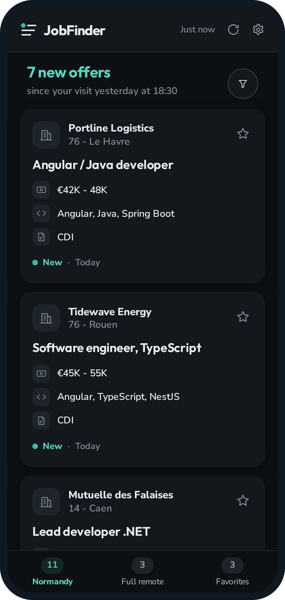
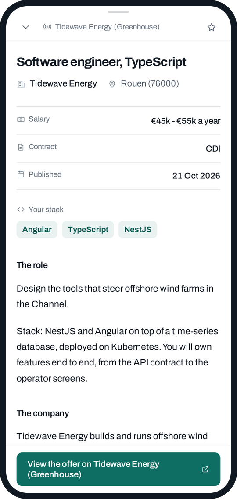
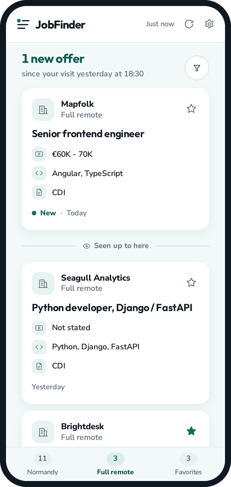
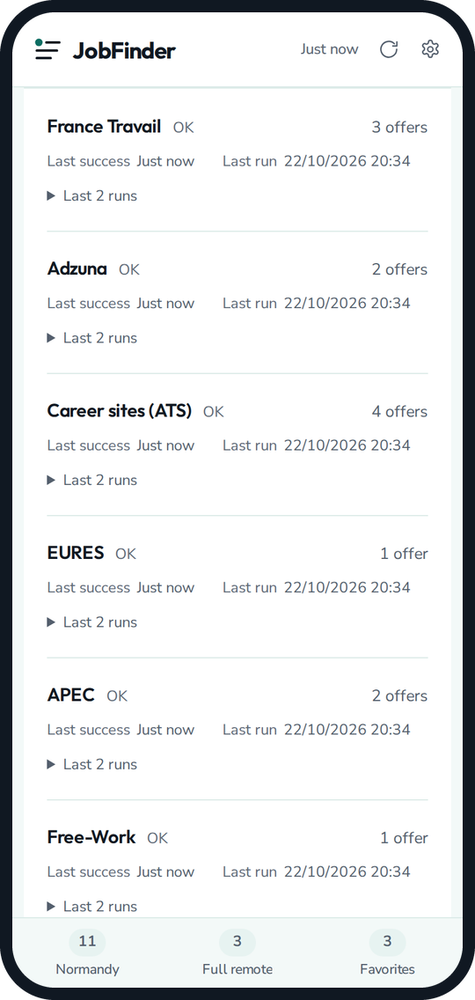
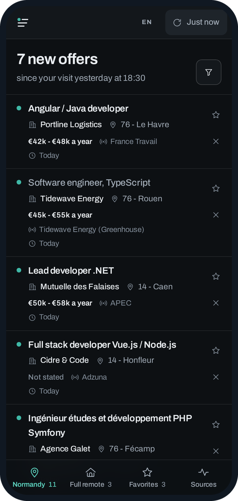
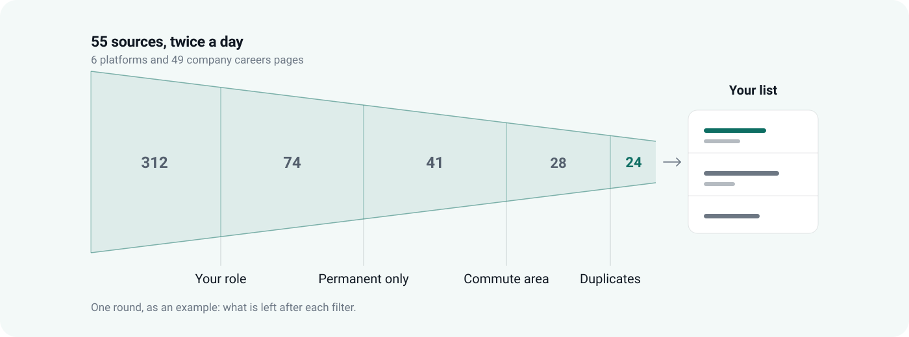
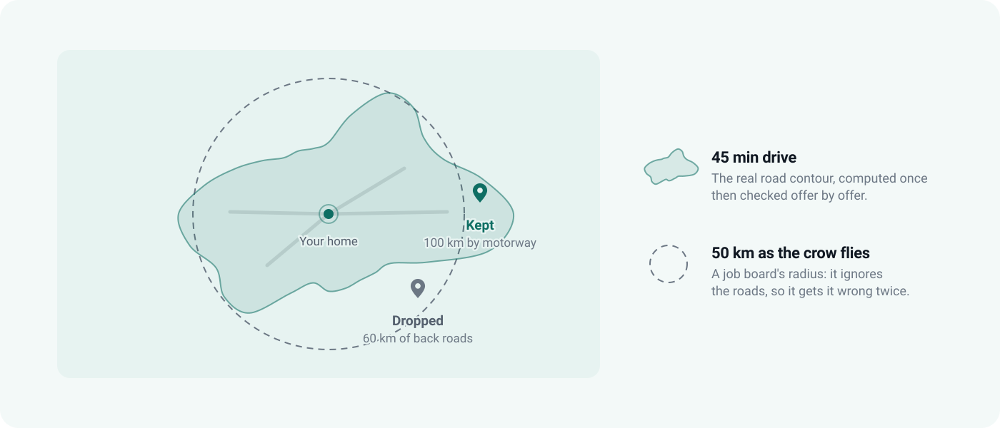
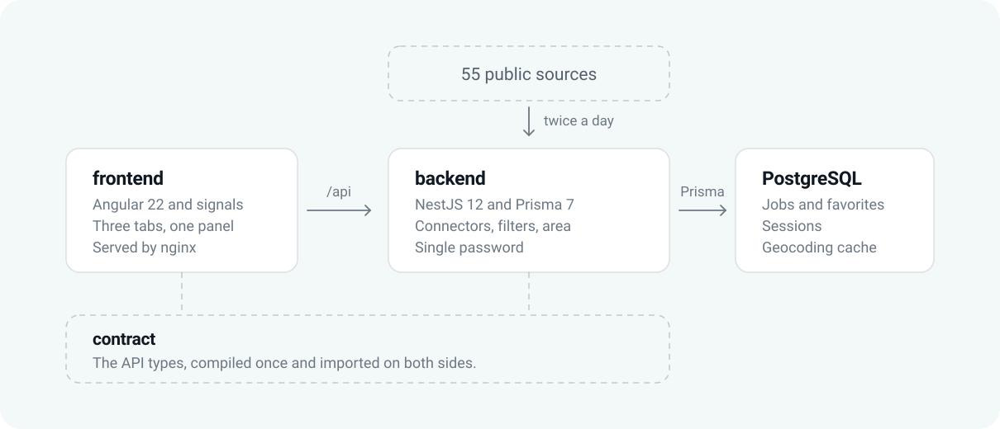

<p align="center">
  
</p>

<h1 align="center">Job Finder</h1>

<p align="center">
  <b>Your job watch, done before your coffee.</b><br>
  Fifty-five sources, one list: permanent jobs, in your stack, within your commute.<br>
  Only what is new since yesterday.
</p>

<p align="center">
  
  
  
  
</p>

<p align="center">
  
  <br>
  <sub>A 40-second tour. Fictitious offers, real app.</sub>
</p>

## Job hunting is a daily chore

France Travail with the morning coffee, Adzuna at lunch, APEC in the evening, Free-Work when you
remember it, and the careers pages of the companies you would actually love to join. Retype the
job title. Tick "permanent" again. Narrow the area again. Scroll past yesterday's listings. Meet the
same offer three times, on three boards.

An hour a day, for three genuinely new offers.

**Job Finder does the round for you.**

## A peek inside

<p align="center">
  
  
  
  
  
  <br>
  <sub><b>The&nbsp;feed</b> · <b>The&nbsp;offer</b> · <b>Full&nbsp;remote</b> · <b>Sources</b> · <b>After&nbsp;dark</b></sub>
</p>

## The round is done before you get there



Morning and evening, Job Finder reads fifty-five sources and throws away everything that is not for
you. An offer posted on three boards shows up once, in its most complete version, with a link to
each board. An offer taken down disappears from the list. Your favorites stay.

## A commute area, not a radius



The area is a real driving-time contour. A job 100 km away by motorway gets in, a job 60 km away
on back roads does not. When a listing hides the town, the offer is kept and flagged rather than
dropped in silence.

## Why you will like it

<table>
  <tr>
    <td width="50%" valign="top">
      <br>
      <b>Picky on your behalf</b><br>
      Internships, apprenticeships, freelance missions and "business developer" roles never get
      through the door. Neither does an ad that names none of your technologies.
    </td>
    <td width="50%" valign="top">
      <br>
      <b>Star it, or let it go</b><br>
      A <b>New</b> badge on whatever arrived since your last visit, a star to keep it. Every other
      offer is deleted a month after its publication; favorites are never purged.
    </td>
  </tr>
  <tr>
    <td width="50%" valign="top">
      <br>
      <b>Remote has its own tab</b><br>
      One hundred percent remote offers from anywhere, next to the ones a short drive away.
    </td>
    <td width="50%" valign="top">
      <br>
      <b>Nothing moves without you</b><br>
      No automatic application, no message sent in your name, no profile dropped anywhere. It
      reads public listings, you decide.
    </td>
  </tr>
  <tr>
    <td width="50%" valign="top">
      <br>
      <b>It is yours</b><br>
      Your machine or your server, one password. Favorites and history stay in your database. No
      tracker, nothing resold.
    </td>
    <td width="50%" valign="top">
      <br>
      <b>Any job, any town</b><br>
      Job title, keywords, stack, home town and commute time live in one file. Angular developer
      in Le Havre today, sales engineer in Nantes tomorrow.
    </td>
  </tr>
</table>

Add it to the home screen and it feels like an app: full screen, its own icon, French or English,
light or dark, following the phone.

## A typical morning

|          |                                                                 |
| -------- | --------------------------------------------------------------- |
| **8:02** | You open the app from the icon on your home screen.             |
| **8:03** | Four offers flagged New. Two do not speak to you: cross, cross. |
| **8:05** | A third one interests you: star. You apply to the fourth.       |
| **8:06** | Done. The day's watch is over. Coffee is still hot.             |

## Where the offers come from

France Travail (which also relays Indeed, DirectEmploi and its other partners), Adzuna, APEC,
EURES, Free-Work, Jooble, and 49 company careers sites read directly (Doctolib, Dataiku, Alan,
Qonto, Swile, and in Normandy Sopra Steria, Matmut and Capgemini). A source that is down or not
configured is simply skipped, the others keep filling the list, and the Sources screen, behind the
gear at the top right, tells you which one is sulking. APEC answers every script with a bot
challenge since October 2026, so the example settings switch it off (`INGESTION_DISABLED_SOURCES`);
its offers still arrive relayed by Adzuna and France Travail.

## Get it

You bring the job title, Job Finder brings the rest.

**Try it** in one command, nothing to configure, a handful of fictitious offers included:

```bash
docker compose up --build    # or: make up
```

Then open http://localhost:8001 and sign in with `job-finder-demo-password`.

**Host it** for yourself: two Docker images (web and API, amd64) and a PostgreSQL database. Your server writes its own compose, chart or PaaS settings from the contract in [docs/deployment.md](docs/deployment.md): one route, a few variables, one database.

**Hack on it**: `make setup && make db && make migrate && make dev`, then [CONTRIBUTING.md](CONTRIBUTING.md#up-and-running).

## Under the hood

<details>
<summary>Stack, quality and supply chain</summary>
<br>



- **Contract**: the API types in one npm workspace, imported by both halves, so a renamed field breaks the build rather than a screen.
- **Frontend**: Angular 22 (standalone, zoneless, signals, `httpResource`), Tailwind 4 for layout, SCSS for visuals, Transloco for French and English, self-hosted Figtree, served by nginx.
- **Backend**: NestJS 12 on Node 22, Prisma 7 and PostgreSQL 17, a zod-validated environment, one connector per job board.
- **Auth**: one shared password (scrypt), a session token, a sign-in throttle, and a production API that refuses to run open.
- **Deployment**: two images. Your proxy sends the domain to the frontend, which relays the API to the backend; `/readyz`, `/healthz` and an ingestion heartbeat feed your uptime monitor.
- **Quality**: type-aware ESLint with a comment on every declaration and enforced layering, Stylelint, Prettier, vitest with coverage floors and an architecture test, Playwright against the images.
- **Supply chain**: images and actions pinned by digest, npm install scripts allow-listed, Dependabot, CodeQL, a Grype scan, an SBOM and provenance on every image.

</details>

- [CONTRIBUTING.md](CONTRIBUTING.md): setup, code map, conventions. Start here.
- [backend/README.md](backend/README.md): daily commands, password, probes, packages.
- [frontend/README.md](frontend/README.md): daily commands, folders, translations, styles.
- [docs/deployment.md](docs/deployment.md): images, routing, variables, backups, monitoring.
- [tools/tour/README.md](tools/tour/README.md): how the tour and the screens above are recorded.
