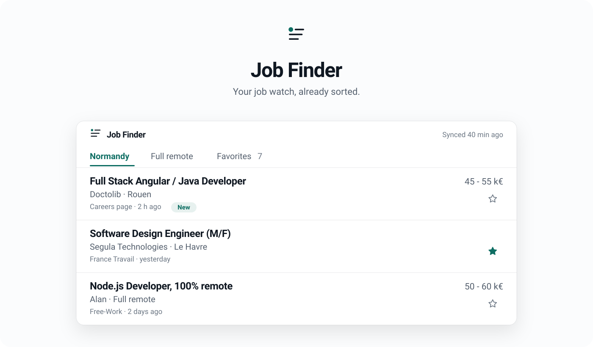

<p align="center">
  
</p>

<p align="center">
  <b>A job aggregator for one person: you.</b><br />
  Permanent contracts only, your job only, only where you are willing to commute.<br />
  No search form, no filters to tick again, no email alerts to sort through.
</p>

<br />

## The problem

Looking for a job means doing the same round every single day. France Travail in the morning,
Adzuna at noon, APEC in the evening, Free-Work when you remember it, and the "Careers" pages of
the companies you would actually like to join. Every time: retype the job title, tick permanent
again, narrow the area again, scroll past yesterday's listings, stumble three times on the same
offer republished by three platforms, and lose the one you had spotted the day before.

An hour a day of handling, for three genuinely new offers.

## The round is done before you get there


Job Finder queries fifty-five sources every two hours and keeps only what concerns you. An offer
published on three platforms shows up once: the most complete version is kept, the links to each
one are gathered on the same row. An offer pulled from the sites disappears from the list. Your
favorites stay.

## Three tabs, nothing else

<p>
  
  <b> Your area</b><br />
  The jobs actually reachable from home, measured in driving time.
</p>

<p>
  
  <b> Full remote</b><br />
  The one hundred percent remote jobs, wherever they are.
</p>

<p>
  
  <b> Favorites</b><br />
  What you have set aside. Protected, never purged.
</p>

On every row: the **New** badge on whatever arrived since your last visit, a star to keep it, a
cross to never see the listing again. One click opens the detail next to the list without making
it disappear; a second one sends you to the original listing to apply.

## A commute area, not a radius


The area is a real driving-time contour, computed once then checked offer by offer. A job 100 km
away by motorway gets in, a job 60 km away on back roads does not. When the source does not give
the town, the offer is kept and flagged rather than dropped in silence.

## What sets it apart

<p>
  
  <b> The sorting is strict</b><br />
  Apprenticeships, internships, freelance missions and "business developer" roles never make it
  through the door. Neither does a listing that mentions no technology from your stack.
</p>

<p>
  
  <b> Nothing moves without you</b><br />
  No automatic applications, no message sent on your behalf, no profile dropped anywhere. The app
  reads public listings and presents them to you.
</p>

<p>
  
  <b> It is yours</b><br />
  The app runs on your machine or your server, behind a single password. Your favorites, your
  hidden offers and your history never leave your database. No tracker is loaded, no data is
  resold.
</p>

<p>
  
  <b> It adapts to you</b><br />
  The job title, the keywords, the technologies, the reference town and the commute time all fit
  in one configuration page. Angular developer in Le Havre today, sales engineer in Nantes
  tomorrow: same app, one file edited.
</p>

## A typical day

|          |                                                                 |
| -------- | --------------------------------------------------------------- |
| **8:02** | You open the app from the icon on your home screen.             |
| **8:03** | Four offers flagged New. Two do not speak to you: cross, cross. |
| **8:05** | A third one interests you: star. You apply to the fourth.       |
| **8:06** | Done. The day's watch is over.                                  |

## The sources covered

France Travail (which also relays Indeed, DirectEmploi and its other partners), Adzuna, APEC,
EURES, Free-Work, Jooble, and 49 company careers sites queried directly (Doctolib, Dataiku, Alan,
Qonto, Swile, and in Normandy Sopra Steria, Matmut and Capgemini). A source that is unavailable or
not configured is simply skipped: the others keep filling the list. The Sources tab shows each
one's health, last successful sync, offer count and recent runs.

## Where it lives

Installed on a server, it opens from any browser, on desktop as well as on a phone. Added to the
home screen, it behaves like a native app: full screen, its own icon, light or dark theme
following your system.

It speaks French and English. It opens in whichever of the two your browser asks for, and the
button in the header switches it at any time, including before the password screen.

## Get it

You bring the job title, Job Finder brings the rest.

**Try it** in one command, nothing to configure, a handful of fictitious offers included:

```bash
docker compose up --build    # or: make up
```

Then open http://localhost:8001 and sign in with `job-finder-demo-password`.

**Host it** for yourself: two Docker images (web and API, amd64) and a PostgreSQL database. Your server writes its own compose, chart or PaaS settings from the contract in [docs/deployment.md](docs/deployment.md): one route, a few variables, one database.

**Hack on it**: `make setup && make dev`, then [CONTRIBUTING.md](CONTRIBUTING.md#up-and-running).

## Under the hood

<details>
<summary>Stack, quality and supply chain</summary>
<br>


- **Contract**: the API types in one npm workspace, imported by both halves, so a renamed field breaks the build rather than a screen.
- **Frontend**: Angular 22 (standalone, zoneless, signals, `httpResource`), Tailwind 4 for layout, SCSS for visuals, Transloco for French and English, self-hosted Archivo, served by nginx.
- **Backend**: NestJS 12 on Node 22, Prisma 7 and PostgreSQL 17, a zod-validated environment, one connector per job board.
- **Auth**: one shared password (scrypt), a session token, a sign-in throttle, and a production API that refuses to run open.
- **Deployment**: two images. Your proxy sends the domain to the frontend, which relays the API to the backend; `/readyz`, `/healthz` and an ingestion heartbeat feed your uptime monitor.
- **Quality**: type-aware ESLint with a comment on every declaration and enforced layering, Stylelint, Prettier, vitest with coverage floors and an architecture test, Playwright against the images.
- **Supply chain**: images and actions pinned by digest, npm install scripts allow-listed, Dependabot, CodeQL, a Grype scan, an SBOM and provenance on every image.

</details>

- [CONTRIBUTING.md](CONTRIBUTING.md): setup, code map, conventions. Start here.
- [backend/README.md](backend/README.md): daily commands, password, probes, packages.
- [frontend/README.md](frontend/README.md): daily commands, folders, translations, styles.
- [docs/deployment.md](docs/deployment.md): images, routing, variables, backups, monitoring.
